 

 

## 👋 whoami

  

<!--
  Slot for a favourite gif. Drop the file into assets/ and uncomment:

  

-->

## 🌙 About me

| | |
| :-- | :-- |
| 🪪 **Name** | Kiruhin Artem |
| 📍 **Country** |  Russian Federation |
| 💻 **What I do** | System administrator, software developer |
| 🌱 **Currently learning** | AI, backend, DevOps |
| 🐧 **Setup** | Arch (btw) + Hyprland |
| 🏋️ **Outside of code** | Gymrat |
| 🖤 **Project** | [Onyx](https://github.com/nullreferenceenjoyer/onyx) — a self-hosted Obsidian in the browser |

## 📬 Contacts

## 📊 Stats

