 

 

## 👋 Кто здесь · whoami

  

<!--
  Место под любимую гифку. Положи файл в assets/ и раскомментируй:

  

-->

## 🌙 Обо мне · about

<!-- ЗАГЛУШКИ: замени правый столбец на свои данные, лишние строки просто удали -->

| | |
| :-- | :-- |
| 🪪 **Имя** | Фамилия Имя Отчество |
| 🎂 **Возраст** | 00 лет |
| 📍 **Город** | Город, страна |
| 💻 **Чем занимаюсь** | Пара слов о том, что ты делаешь |
| 🌱 **Сейчас изучаю** | Технология или тема |
| 🎮 **Вне кода** | Аниме, игры, музыка — что угодно |

## 📬 Контакты · contacts

<!-- ЗАГЛУШКИ: поменяй адреса в href на свои -->

## 📊 Статистика · stats

